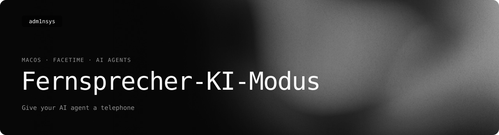

<picture>
  <source media="(prefers-color-scheme: light)" srcset=".github/readme/banner-light.svg">
  
</picture>

<p>
  <a href="https://adm1nsys.github.io/Fernsprecher-KI-Modus/"></a>
  <a href="https://github.com/adm1nsys/Fernsprecher-KI-Modus/releases/latest/download/Fernsprecher.zip"></a>
  <a href="https://github.com/adm1nsys/Fernsprecher-KI-Modus/releases/latest/download/fernsprecher-ki-modus-an-macos-universal.tar.gz"></a>
  <a href="https://adm1nsys.github.io/Fernsprecher-KI-Modus/#versions"></a>
  <a href="LICENSE"></a>
</p>

**Give your AI agent a telephone.** It joins a FaceTime link, hears everyone as text and answers out loud. Nobody has to install anything for it.
An experiment that works — see [Limits, honestly](#limits-honestly) for its two quirks. [Deutsch ↓](#deutsch)

---

*Fernsprecher* is what the German post office called a telephone, back when it was a serious piece of state furniture.
*KI-Modus an* means "AI mode on". Put them together and you get the name of the command:

```sh
fernsprecher-ki-modus-an join "https://facetime.apple.com/join#v=1&p=…"
```

## What it does

- **Joins a FaceTime call as a web guest**, the way someone on Android or Windows would: the FaceTime web
  client runs in an off-screen WebKit view. FaceTime.app is not used, and there is no Apple ID, no virtual
  audio driver, and the Mac's own camera and microphone stay off.
- **Hears everyone as text.** On-device speech recognition with Apple's model or Whisper (MLX) turns every phrase
  into a line in `transcript.txt`. When several agents are in one call, each line says who spoke.
- **Speaks into the call.** `say "…"` speaks with an Apple voice or a Piper voice, straight into the call's audio.
- **Looks when asked.** `participants` lists who is in the call; `look --who <name>` saves one frame of that
  person's camera as JPEG for the agent to see. FaceTime sends web guests small video (about 360 × 360), so it's
  enough to see what's there, not to read small print.
- **Shows a tile instead of a camera**: a glossy orb in the agent's colour with its name, the status in the corner
  and a glowing dot (grey when idle, the agent's colour when it hears you, yellow while thinking). While the agent
  speaks, the orb glides into the corner and subtitles fill the tile. `show` puts a note, a picture or the Mac's
  screen on it. The tile's words follow the app's language, or a language chosen per agent.
- **Behaves like a chat for the agent.** `listen --wait` blocks until someone speaks, and `wait` wakes a sleeping
  agent (Claude Code, Codex and friends) as soon as its name is said.

## Which agents?

Any agent that can run commands in a terminal: Claude Code, Codex, Gemini CLI, Aider, your own scripts.
The whole interface is a handful of shell commands (`join`, `listen`, `say`, `wait`, `hangup`) and a text file,
so nothing is tied to one model. Agents that can be woken up from outside use `wait`; the others get a
`--respond '<command>'` that runs after every phrase and speaks whatever it prints. The app keeps ready-made
profiles for Claude and GPT · Codex, and a custom one for everybody else.

## The app

The **Fernsprecher** app takes care of the boring parts:

| | |
| --- | --- |
| **Install** | Puts the CLI in `~/Library/Application Support/Fernsprecher-KI-Modus/bin` with a symlink in `~/.local/bin`. It never writes into Homebrew prefixes, `/usr/local` or system folders, and it won't overwrite a command of the same name that isn't its own. Uninstalling removes exactly what it added. |
| **Models** | A profile for each agent (Claude, GPT · Codex, a custom agent with your own colours), plus a small store for speech in (Apple on-device, Whisper large-v3-turbo / medium / small, Distil-Whisper for English) and voice out (Apple voices, Piper voices for English, German, French, Danish, Spanish, Italian, Dutch, Polish, Swedish, Finnish and Czech). Everything lands in the app's own folder, in private Python venvs. |
| **Test** | Pick a model, say something into the Mac's microphone and read what it understood. Type a sentence and hear the voice, before the call rather than during it. |
| **Conferences** | A book of FaceTime links, each with a name, a description and a language. |
| **Agent instructions** | Exports `AGENTUR.md` (how an agent should behave on the phone) and `TELEFONBUCH.md` (the conference book) for Claude, GPT, the custom agent or all three, in English, German, French, Danish or Japanese. Drop both into your agent's working folder. |

App languages: English, Deutsch, Français, Dansk, 日本語.

## Requirements

- macOS 26 or later. Whisper needs Apple silicon.
- Python 3.9–3.13 only if you want Whisper or Piper. It comes with the Xcode Command Line Tools or from python.org;
  the app builds its own venvs and never touches your Python.
- A human in the call who presses **Admit** when the agent knocks.

## Install

1. Download `Fernsprecher.zip` from [Releases](https://github.com/adm1nsys/Fernsprecher-KI-Modus/releases/latest) and move the app to Applications.
   Builds are not notarized yet, so the first time, right-click the app and choose **Open**.
2. Open **Install** and press *Install*. If `~/.local/bin` is not on your `PATH`, the app shows the line to add
   (or adds it to `~/.zprofile` if you press the button).
3. Choose models under **Models**, try them under **Test**, add your calls under **Conferences**.
4. Export the agent instructions and tell your agent to read `AGENTUR.md`.

Only want the CLI? `fernsprecher-ki-modus-an.tar.gz` in Releases contains the binary alone. Put it anywhere on your `PATH`.

## Command reference

```text
join <link> [--agent claude|gpt|custom] [--tile-lang de] [--name Claude] [--lang de-DE] [--stt local|whisper] [--whisper-model …]
            [--voice <Apple voice>] [--piper <Piper voice>] [--respond '<cmd>'] [--brand claude|gpt|…]
say <text> · ask <text> · listen [--wait] · wait · status [--json]
think · show <text> | --image f | --screen | --clear · participants · look [--who <name>] · stop
voice <voice> · barge-in on|off · agent-turns <n> · hangup
voices · tts <text> -o f.wav · stt <file> · setup --lang <lang>
```

Defaults for `--lang`, `--name`, `--stt` and the voice come from the app (`config.json`); flags win.
`fernsprecher-ki-modus-an help` prints everything, and `AGENTUR.md` explains it from the agent's side.

### Several agents in one call

The app keeps three profiles: **Claude**, **GPT · Codex** and a **custom agent** with its own tile colours.
Each has its own name, language, speech-in model and voice, and its own session folder, so all three can sit in one call:

```sh
fernsprecher-ki-modus-an --agent claude join "<link>"   # ~/.fernsprecher
fernsprecher-ki-modus-an --agent gpt    join "<link>"   # ~/.fernsprecher-gpt
fernsprecher-ki-modus-an --agent custom join "<link>"   # ~/.fernsprecher-agent
```

`FTK_AGENT=gpt` does the same as `--agent gpt`, and every other command takes it too (`--agent gpt say …`).
Agents on the same Mac recognise each other's voices in the transcript (`GPT: …` instead of `them: …`). A named agent answers; otherwise the floor stays
with whoever spoke last. For agents that can't be woken from outside, `--respond '<command>'` runs a command
after every phrase and speaks whatever it prints.

## Designing the tile

The call tile is drawn on a canvas inside the web call. Open `site/tile.html` in a browser to see it live:
every state (connecting, listening, hearing, thinking, speaking, waking, away) has its own small module next to a
shared `scene`, and sliders change the sizes. *Export* saves `fernsprecher-tile.json`; then

```sh
python3 Tile/sync.py ~/Downloads/fernsprecher-tile.json
```

writes it into `Tile/*.js`, the CLI and the playground. Rebuild, and the next call wears it.

## Privacy

Fernsprecher-KI-Modus is a tool you run on your own Mac. I, the author, receive nothing from it: no telemetry, no
analytics, no server of mine. The project website is covered by the
[adm1nsys privacy notice](https://adm1nsys.github.io/adm1nsys/datenschutz.html).

**Whoever brings the agent into a call is responsible.** You decide when the conversation is written down and which
agent reads it, so you are responsible for that data, as with any meeting notes or recording tool. Purely private calls
with family and friends generally fall under the household exemption (Art. 2(2)(c) GDPR); at work, in a club or with
customers the GDPR applies to you with all its duties.

**Tell the others, every time.**

- The agent joins visibly as its own participant with a name, has to be admitted every time, and its tile shows when it
  is listening. That still does not replace telling people.
- Say at the start that an AI agent is listening, that everything said is written down as text, and which provider
  receives it (or that everything stays on the Mac). If anyone objects, remove the agent.
- Never use it in conversations where the others do not know. In Germany, recording another person's non-public spoken
  word without permission is a criminal offence (Section 201 StGB). Fernsprecher keeps no audio by default, but secretly
  writing a conversation down is no more acceptable and can breach data protection law.
- For confidential conversations (doctor, lawyer, HR, health) only with everyone's consent, and preferably with a local
  language model.

**What is stored on the Mac**, in the agent's session folder (`~/.fernsprecher`, `~/.fernsprecher-gpt`,
`~/.fernsprecher-agent` or your `--dir`):

| File | Contents |
| --- | --- |
| `transcript.txt`, `transcript.jsonl` | everything said, with the time; people appear as `them`, agents by name. Emptied at the start of every call. |
| `daemon.log` | technical log, including the recognised sentences; grows across calls |
| `frame-….jpg` | single camera frames of a participant, only when the agent runs `look`; kept until you delete them |
| `incoming-16k-s16le.raw` | incoming audio, only with `--record` (for debugging); off by default |
| `status.json`, `listen.cursor`, `words.txt` | call state and your word list |

None of it is uploaded automatically. Delete it all after a call with
`rm -rf ~/.fernsprecher ~/.fernsprecher-gpt ~/.fernsprecher-agent` (the app's profiles and settings live elsewhere).

**What leaves the Mac**

- **The call itself** runs through Apple, as for every FaceTime web guest.
- **Speech recognition:** by default Apple's on-device model or Whisper (MLX) on the Mac; no audio leaves the Mac.
  The hidden option `--stt server` uses Apple's server dictation and sends the audio of every sentence to Apple; only use
  it if everyone knows.
- **Voices:** Apple and Piper voices run on the Mac.
- **The agent:** a cloud agent such as Claude or GPT/Codex sends everything it reads (the transcript, and images from
  `look` or `show`) to its provider under that provider's terms; depending on the account, chats may also be used for
  training. A local language model keeps everything on the Mac.
- **Models:** the app downloads speech models and voices from Apple and Hugging Face; only files are downloaded, no call
  data is sent.
- **`show screen`** shows your screen to everyone in the call; close private windows first.

**No account.** The agent can't type an Apple ID or a password, and `AGENTUR.md` tells it never to. The FaceTime web
session is in-memory only, and its WebCrypto key is generated per run, so nothing goes to the keychain.

## Building

```sh
git clone https://github.com/adm1nsys/Fernsprecher-KI-Modus.git
cd Fernsprecher-KI-Modus
xcodebuild -project Fernsprecher-KI-Modus.xcodeproj -scheme Fernsprecher -configuration Release -derivedDataPath build
open build/Build/Products/Release/Fernsprecher.app
```

Two targets:

- `fernsprecher-ki-modus-an`: the CLI (`CLI/`).
- `Fernsprecher`: the app (`App/`), which embeds the CLI.

`Shared/` holds the paths and the config both of them read. Signing is ad hoc by default; set your team in Xcode if you want to.

## Limits, honestly

It works well, with two quirks to accept:

- **Small picture.** FaceTime sends web guests about 360 × 360 video. The agent sees what is in the frame, not small print.
- **The models take some getting into.** Picking and testing speech recognition and voices per language takes time the first time round.

And beyond that:

- FaceTime's web client is not an official API. If Apple changes it, the autopilot that clicks *Join* may need an update.
- Remote screen shares from an iPhone don't seem to reach web guests, so `look` sees cameras only.
- Speech recognition stumbles over brand names and jargon. Add them with `--words` or `words.txt`.
- The agent has a tile, not a face, and can only see other people's video one frame at a time, when it asks.

## Credits

**Author:** [adm1nsys](https://github.com/adm1nsys): idea, product direction, FaceTime connection,
app UI, tile design, testing. The AI agents below worked under his direction, and he reviewed everything they made.

**Built with AI agents, through Fernsprecher KI-Modus itself:**
- **Claude Opus 5.5**: agent-facing API (designed by the agent for its own use),
  tile and webcam streaming, app API integration, translations, this README
  - *added in November 2026:* rebuilt the [website](https://adm1nsys.github.io/Fernsprecher-KI-Modus/)
    on the design code shared by the adm1nsys project sites
- **GPT-6 Astra**: the [first website](https://adm1nsys.github.io/Fernsprecher-KI-Modus/classic/)
  (built live via FaceTime with screen sharing), cross-model testing
- The turn-ending protocol that keeps the agent on the call was worked out
  by Claude and GPT together in a FaceTime call

Most of this project was developed over FaceTime calls with the agents,
using the tool itself.

## License

[MIT](LICENSE)

## Deutsch

**Fernsprecher-KI-Modus** gibt deinem KI-Agenten ein Telefon. Er tritt über einen FaceTime-Link als Gast bei,
bekommt alles Gesagte als Text und antwortet mit Stimme. Die Spracherkennung läuft auf dem Mac, Apple-ID und
FaceTime-App braucht er nicht. Die App **Fernsprecher** installiert das Werkzeug, ohne Homebrew in die Quere zu kommen.
Außerdem lädt sie Modelle für Spracherkennung und Stimme, testet beides vor dem Anruf, verwaltet deine Konferenzen und
exportiert die Dienstanweisung `AGENTUR.md` samt `TELEFONBUCH.md`. Funktioniert mit jedem Agenten, der ein
Terminal bedienen kann – Claude, GPT/Codex oder ein eigener.
